  
  

  
  

  <a href="https://github.com/VictorAndreon/Clawd-mini">Clawd-mini</a> ·
  <a href="https://github.com/VictorAndreon/projeto-TOO-orquestrador-usina-prioridade">Orquestrador</a> ·
  <a href="https://linkedin.com/in/victor-hugo-andreon-de-camargo">LinkedIn</a> ·
  victorcamargoandreon@gmail.com

