  

### Projetos

| | |
|---|---|
| [**Clawd-mini**](https://github.com/VictorAndreon/Clawd-mini) | Mascote de desktop pro Linux que reage em tempo real ao Claude Code, via hooks da CLI + `fs.watch` (TypeScript, Electron) |
| [**Orquestrador por prioridade**](https://github.com/VictorAndreon/projeto-TOO-orquestrador-usina-prioridade) | Fila de prioridade com Factory/Observer e testes automatizados (Python) |

### Contato

[LinkedIn](https://linkedin.com/in/victor-hugo-andreon-de-camargo) · victorcamargoandreon@gmail.com
